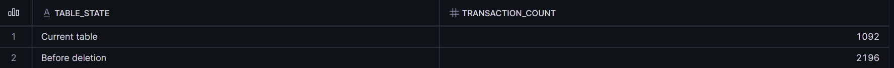
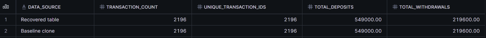
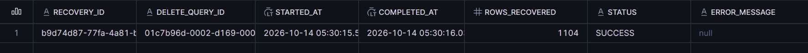
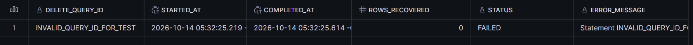
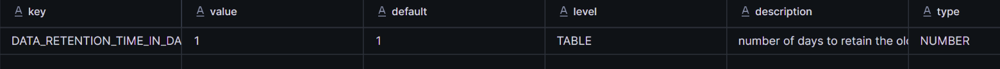
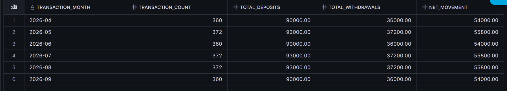

# Financial Transaction Recovery & Data Protection

A Snowflake portfolio project by Jasper John Calabio.

**Guided learning project using synthetic banking data. FinTrust Digital Bank is fictional, not a real client.**

## Business Problem

Simulate the accidental deletion of three months of banking transactions, recover the missing records, and validate the recovered data against the original records.

## Tools Used

- Snowflake
- SQL
- Snowflake Time Travel
- Zero-copy cloning
- SQL stored procedures
- Audit logging

## Project Objectives

- Create a banking database with customers, accounts, branches, and transactions.
- Generate six months of fictional transaction data.
- Simulate accidental deletion.
- Recover deleted records using Time Travel.
- Automate recovery and record successful and failed attempts.
- Validate transaction counts and financial totals.
- Analyze transactions by month, account type, and branch location.

## Dataset

The dataset covers **April–September 2026** and contains:

- 3 branches
- 6 customers
- 6 accounts
- 2,196 transactions

Each account receives a fictional **PHP 500 deposit** and **PHP 200 withdrawal** every day.

## Results

| Check | Observed Result |
| --- | ---: |
| Original transactions | 2,196 |
| July–September transactions deleted | 1,104 |
| Transactions remaining after deletion | 1,092 |
| Transactions restored in the automated test | 1,104 |
| Final transactions | 2,196 |
| Unique transaction IDs | 2,196 |
| Total deposits | PHP 549,000 |
| Total withdrawals | PHP 219,600 |
| Net movement | PHP 329,400 |

The original recovery exercise also produced zero account-level differences in counts and amounts.

These results came from the learner-run Snowflake session. The reorganized repository scripts have not been re-executed in Snowflake.

## Project Evidence

The following screenshots document the original recovery exercise. The later repair of accidentally duplicated data is described separately below.

### 1. Confirming the Deletion

After deleting July–September transactions, the current table contained **1,092 records**, compared with **2,196 records** before deletion.

The difference was **1,104 missing transactions**.

### 2. Validating the Recovered Totals

After recovery, the transaction table matched the baseline clone:

- 2,196 transactions
- 2,196 unique transaction IDs
- PHP 549,000 in deposits
- PHP 219,600 in withdrawals

### 3. Reconciling Individual Accounts

Each account was compared against the baseline.

All six accounts showed **zero differences** in transaction counts, deposit totals, and withdrawal totals.

### 4. Recording Successful Automated Recovery

The stored procedure recovered **1,104 transactions** during the automated test.

The audit log recorded:

- Status: SUCCESS
- Rows recovered: 1,104
- Error message: NULL

### 5. Testing Failure Handling

An intentionally invalid query ID tested the procedure’s error-handling path.

The audit log recorded:

- Status: FAILED
- Rows recovered: 0
- An error message explaining the failure

Some long fields are clipped in the original screenshot.

### 6. Checking Time Travel Retention

The transaction table’s Time Travel retention was configured and verified as **1 day**.

This verifies the retention setting; it does not demonstrate a Fail-safe recovery.

### 7. Reviewing Monthly Transaction Trends

The recovered data includes all six months from April through September 2026.

- Months with 30 days contain 360 transactions.
- Months with 31 days contain 372 transactions.
- Net movement equals deposits minus withdrawals.

These differences follow the fixed daily sample-data pattern, not changes in real customer behavior.

## Implementation Summary

I created the banking tables, loaded synthetic data, and created a baseline clone for comparison.

I then simulated a deletion and used Time Travel with the BEFORE clause to retrieve the missing transactions. A missing-ID check prevented reinserting transactions already present.

Next, I created a stored procedure to automate recovery and record execution details. Recovery and success logging were grouped in a transaction, with error handling that attempted to record failures after rollback.

Finally, I compared counts and financial totals against the baseline and created account-level and monthly summaries.

## Repository Files

| File | Purpose |
| --- | --- |
| [01_setup.sql](sql/01_setup.sql) | Tables, sample data, retention, and baseline clone |
| [02_manual_recovery.sql](sql/02_manual_recovery.sql) | Deletion simulation, manual recovery, and reconciliation |
| [03_automated_recovery.sql](sql/03_automated_recovery.sql) | Recovery procedure, audit log, and test cases |
| [04_validation_and_analytics.sql](sql/04_validation_and_analytics.sql) | Read-only validation and analytics |
| [Screenshot files](screenhots/) | Evidence displayed on this page |

## Running the SQL Safely

**Do not rerun setup on the existing completed lab.**

Files 01–03 are disabled with SQL line comments to prevent accidental inserts or deletions. File 04 contains read-only queries.

For a deliberate new practice run:

1. Choose a separate, unused lab database name and replace FINTRUST_RECOVERY_LAB throughout all four scripts.
2. Use a Snowflake role with the necessary permissions and a usable warehouse. Warehouse usage may incur charges.
3. Remove one leading `-- ` only from the statement you intend to execute. Do not uncomment the entire file.
4. Run setup and sample-data inserts once. Confirm the baseline contains 2,196 transactions before deleting anything.
5. Immediately after each DELETE, run SELECT LAST_QUERY_ID() in the same session, with no other statement in between.
6. Replace REPLACE_WITH_FIRST_DELETE_QUERY_ID and REPLACE_WITH_SECOND_DELETE_QUERY_ID with the corresponding IDs from your own run.
7. Complete recovery while the required Time Travel history remains available.
8. Run the complete CREATE PROCEDURE statement through its closing `$$;` as one unit.
9. Keep INVALID_QUERY_ID_FOR_TEST unchanged for the intentional failure test.
10. Use file 04 to validate results.

IF NOT EXISTS does not prevent repeated INSERT statements from adding duplicate rows. If a clone or procedure already exists, stop and inspect rather than overwriting evidence.

## Recovery From a Repeat-Run Mistake

Re-running sample-data inserts later introduced duplicate rows.

Before repairing the data, I created a separate BANKING_BEFORE_REPAIR schema clone to preserve its current state.

I then:

- Restored distinct branch records.
- Restored distinct account records.
- Kept the earliest creation timestamp for each matching customer.
- Restored transactions from the original TRANSACTIONS_BEFORE_DELETE clone.

The final repair check returned:

| Validation | Result |
| --- | ---: |
| Branches | 3 |
| Customers | 6 |
| Accounts | 6 |
| Transactions | 2,196 |
| Unique transaction IDs | 2,196 |
| Deposits | PHP 549,000 |
| Withdrawals | PHP 219,600 |

This reinforced the importance of separating setup scripts from read-only reporting queries and preserving a recovery copy before making corrections.

## Lessons Learned

- Check the data before and after recovery.
- Compare financial totals as well as record counts.
- Use a baseline clone for reconciliation.
- Record both successful and failed recovery attempts.
- Capture the correct deletion query ID immediately.
- Avoid rerunning sample-data inserts without checking existing records.
- Keep setup, recovery, and reporting scripts separate.

## Limitations

- The project uses synthetic data, not real banking records.
- The recovery date range is fixed to July–September 2026.
- The missing-ID check does not repair changed values in existing records or address every concurrency scenario.
- Matching counts and sums does not prove every field is identical.
- The audit log is not tamper-proof, and failure logging can itself fail.
- Fail-safe recovery was not executed or tested.
- Geographic analysis uses the account’s branch, not the physical transaction location.
- Net movement excludes opening balances and is not an ending account balance.
