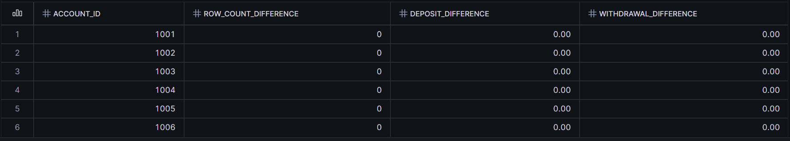

# Financial Transaction Recovery & Data Protection

A Snowflake portfolio project by Jasper John Calabio.

**Guided learning project using synthetic banking data. FinTrust Digital Bank is fictional, not a real client.**

## Business problem

Simulate the accidental deletion of three months of banking transactions, recover the missing records, and check that counts and financial totals match the original data.

## What I practiced

- Creating Customers, Accounts, Branches, and Transactions tables.
- Generating six months of sample transactions.
- Using Time Travel with BEFORE to recover deleted records.
- Creating a zero-copy clone for comparison.
- Automating recovery with a SQL stored procedure.
- Logging successful and failed recovery attempts.
- Comparing record counts, financial totals, and account-level differences.
- Summarizing transactions by month, account type, and branch location.

## Data and results

The dataset covers April-September 2026: 3 branches, 6 customers, and 6 accounts. Each account has a PHP 500 deposit and PHP 200 withdrawal per day.

| Check | Observed result |
| --- | ---: |
| Original transaction count | 2,196 |
| July-September transactions deleted | 1,104 |
| Transactions remaining after deletion | 1,092 |
| Transactions restored in the automated recovery test | 1,104 |
| Final transaction count / unique IDs | 2,196 / 2,196 |
| Total deposits | PHP 549,000 |
| Total withdrawals | PHP 219,600 |
| Net movement (deposits minus withdrawals) | PHP 329,400 |

During the original recovery exercise, the account-level count and amount differences were zero. A repeat recovery returned zero inserted rows, and an intentionally invalid query ID produced a FAILED audit entry.

These results were observed during the learner-run Snowflake session. Original screenshots are presented below. The reorganized repository scripts have not been re-executed in Snowflake.

## Project evidence

These screenshots document the original recovery exercise, before the later repeat-run mistake described below. Click an image to inspect it more closely.

### 1. Confirming the deletion

The current table contained 1,092 transactions, compared with 2,196 before deletion. The difference was 1,104 missing transactions.

### 2. Validating the recovered totals

The recovered table matched the baseline clone: 2,196 rows, 2,196 unique transaction IDs, PHP 549,000 in deposits, and PHP 219,600 in withdrawals.

### 3. Reconciling individual accounts

All six accounts showed zero differences in transaction counts, deposits, and withdrawals when compared with the baseline.

### 4. Recording successful automated recovery

The audit log recorded SUCCESS and 1,104 recovered rows for the automated recovery test, with no error message.

### 5. Recording an intentional failure

An invalid query ID deliberately triggered the error-handling path. The audit log recorded FAILED, zero recovered rows, and an error message. Some long fields are clipped in the original screenshot.

### 6. Checking Time Travel retention

The table-level retention setting was 1 day. This screenshot verifies the setting, not a Fail-safe recovery.

### 7. Reviewing monthly transaction trends

The output includes all six months from April through September 2026. Months with 30 days contain 360 transactions; months with 31 days contain 372. The difference follows the fixed daily sample-data pattern, not a change in real customer behavior.

## Repository files

| File | Purpose |
| --- | --- |
| [01_setup.sql](sql/01_setup.sql) | Tables, sample data, retention, and baseline clone |
| [02_manual_recovery.sql](sql/02_manual_recovery.sql) | Deletion simulation, manual recovery, and reconciliation |
| [03_automated_recovery.sql](sql/03_automated_recovery.sql) | Recovery procedure, audit log, and test cases |
| [04_validation_and_analytics.sql](sql/04_validation_and_analytics.sql) | Read-only checks and summaries |
| [Screenshot files](screenshots/) | Original images embedded on this page |

## Important: do not rerun setup on the existing lab

**The current lab has already been repaired and validated. You do not need to rerun setup to publish this portfolio.**

Files 01-03 are disabled with SQL line comments. This prevents accidental inserts or deletions when the whole file is pasted into a worksheet. File 04 contains only read-only queries.

For a deliberate new practice run:

1. Use a separate, unused lab database name and replace FINTRUST_RECOVERY_LAB throughout all four files. Do not reset the existing lab.
2. Use a Snowflake role with the necessary creation, reading, and writing permissions, plus a usable warehouse. Warehouse usage may incur charges.
3. In file 01, remove one leading `-- ` from only the statement you intend to execute. Run setup/load statements once. Check the counts before continuing. The baseline clone should contain 2,196 rows.
4. In file 02, preview the deletion count first. After DELETE, immediately run SELECT LAST_QUERY_ID() in the same session, without another statement between them.
5. Replace REPLACE_WITH_FIRST_DELETE_QUERY_ID wherever it appears in files 02-03. Recover within available Time Travel history.
6. In file 03, execute the complete CREATE PROCEDURE statement (through the closing $$;) as one unit. The first repeat-recovery call should insert zero rows after manual recovery.
7. For the second deletion test, capture its new ID and replace REPLACE_WITH_SECOND_DELETE_QUERY_ID in file 03. Keep INVALID_QUERY_ID_FOR_TEST unchanged for the intentional failure test.
8. Use file 04 to check the results and save screenshots.

Do not remove all comments and run everything at once. IF NOT EXISTS does not make repeated INSERT statements safe. Creating an existing clone or procedure can fail; stop and inspect instead of overwriting evidence.

## Implementation summary

I created a small banking data model, loaded synthetic transactions, and saved a baseline clone. I then simulated a July-September deletion and recovered missing transaction IDs from the table's pre-deletion history. The procedure combines recovery and success logging in a transaction and attempts to record failures after rollback. Validation compares the recovered table with the clone and summarizes account-level differences.

## Recovery from a repeat-run mistake

Re-running sample-data inserts later introduced duplicate rows. Before repairing them, I created a separate BANKING_BEFORE_REPAIR schema clone. I restored distinct branches and accounts, retained the earliest customer creation timestamp per matching customer, and restored transactions from the original baseline clone.

The final repair check returned 3 branches, 6 customers, 6 accounts, 2,196 transactions, 2,196 unique transaction IDs, PHP 549,000 deposits, and PHP 219,600 withdrawals. This reinforced the need to separate setup scripts from read-only reporting queries.

## Limitations

- Synthetic fixed daily amounts do not represent real customer behavior.
- Recovery is hard-coded to July-September 2026; it is not a general production recovery system.
- The missing-ID check does not correct changed values in existing rows or handle every concurrency scenario.
- Matching counts and sums alone do not prove every field is identical.
- The audit log is not tamper-proof, and failure logging can itself fail.
- One-day Time Travel retention was checked. Fail-safe recovery was not executed or tested.
- Geographic analysis uses the account's branch, not the physical transaction location.
- Net movement is not an ending balance; opening balances are excluded.

## Next portfolio step

Upload the updated main README and the screenshots folder together, preserving the folder name so the embedded images display. Upload only this project's files, not the full bootcamp workspace. Review images before public upload; audit screenshots include execution IDs and timestamps.
